<!-- ======================= HEADER ======================= -->
<div align="center">
  
  <a href="https://github.com/coder1702">
    
  </a>
  <br/>
</div>

<br/>

<!-- ======================= ABOUT ======================= -->

## `~/about`

```python
class Developer:
    name       = "Kalp Shah"
    role       = "Software Developer"
    website    = "https://kalp-shah.pages.dev"
    backend    = ["Python", "FastAPI", "Flask", "Node.js"]
    mobile     = ["Flutter"]
    data       = ["PostgreSQL", "MySQL", "MongoDB"]
    ai_ml      = ["PyTorch", "TensorFlow", "scikit-learn", "Pandas", "NumPy"]
    exploring  = ["Unity", "Cloud Deployment", "API Security"]
    philosophy = "Turn ideas into real-world applications."

    def work(self):
        while True:
            self.build(); self.test(); self.break_it(); self.fix(); self.improve()
```

I enjoy working across the stack: designing APIs and databases, building mobile apps, and experimenting with AI/ML to make products smarter.

<br/>

<!-- ======================= FOCUS ======================= -->

## `~/focus`

<table>
<tr>
<td width="50%" valign="top">

**Currently working on**
- Backend architecture and REST API design
- AI/ML experiments and applied models
- Flutter application development

</td>
<td width="50%" valign="top">

**Currently learning**
- Cloud deployment
- API security
- Unity game development

</td>
</tr>
</table>

<br/>

<!-- ======================= STACK ======================= -->

## `~/stack`

<div align="center">

| Layer | Technologies |
|:--|:--|
| **Languages** |  |
| **Backend** |  |
| **Frontend / Mobile** |  |
| **Databases** |  |
| **AI / ML** |      |
| **Tools** |     |

</div>

<br/>

<!-- ======================= BUILD ======================= -->

## `~/what-i-build`

<div align="center">

| 🤖 **AI Applications** | 🏥 **Healthcare Tech** | 📱 **Mobile Apps** |
|:--:|:--:|:--:|
| Models integrated into real products | Tech that improves care and access | Cross-platform apps with Flutter |
| ⚡ **Backend & APIs** | 📊 **Data & ML** | 🎮 **Games** |
| Clean, documented, scalable services | From raw data to predictions | Interactive experiences in Unity |

</div>

<br/>

<!-- ======================= STATS ======================= -->

## `~/stats`

<div align="center">


<br/>


<br/><br/>


<!-- ======================= CONNECT ======================= -->

## `~/connect`

<div align="center">

<a href="https://kalp-shah.pages.dev/"></a>
<a href="https://www.linkedin.com/in/kalp-shah-0ab751356/"></a>
<a href="mailto:kalpshah03@gmail.com"></a>
<a href="https://github.com/coder1702"></a>

<br/><br/>

```bash
$ echo "Build. Learn. Break. Fix. Repeat."
```


</div>
