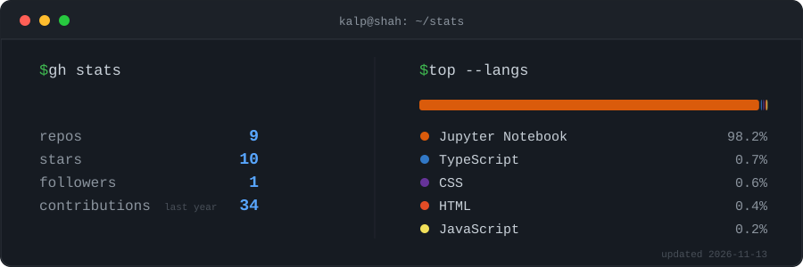

<!-- ======================= HEADER ======================= -->
<div align="center">
  
  <a href="https://github.com/coder1702">
    
  </a>
</div>

<!-- ======================= ABOUT ======================= -->

## `~/about`

```python
class Developer:
    name       = "Kalp Shah"
    role       = "Software Developer"
    website    = "https://kalp-shah.pages.dev"
    backend    = ["Python", "FastAPI", "Flask", "Node.js"]
    mobile     = ["Flutter"]
    data       = ["PostgreSQL", "MySQL", "MongoDB"]
    ai_ml      = ["PyTorch", "TensorFlow", "scikit-learn", "Pandas", "NumPy"]
    exploring  = ["Unity", "Cloud Deployment", "API Security"]
    philosophy = "Turn ideas into real-world applications."

    def work(self):
        while True:
            self.build(); self.test(); self.break_it(); self.fix(); self.improve()
```

I enjoy working across the stack: designing APIs and databases, building mobile apps, and experimenting with AI/ML to make products smarter.

<!-- ======================= FOCUS ======================= -->

## `~/focus`

<table>
  <tr>
    <td width="50%" valign="top">
      <b>🔨 Currently working on</b>
      <ul>
        <li>Backend architecture and REST API design</li>
        <li>AI/ML experiments and applied models</li>
        <li>Flutter application development</li>
      </ul>
    </td>
    <td width="50%" valign="top">
      <b>🌱 Currently learning</b>
      <ul>
        <li>Cloud deployment</li>
        <li>API security</li>
        <li>Unity game development</li>
      </ul>
    </td>
  </tr>
</table>

<!-- ======================= STACK ======================= -->

## `~/stack`

<table>
  <tr>
    <td><b>Languages</b></td>
    <td></td>
  </tr>
  <tr>
    <td><b>Backend</b></td>
    <td></td>
  </tr>
  <tr>
    <td><b>Frontend / Mobile</b></td>
    <td></td>
  </tr>
  <tr>
    <td><b>Databases</b></td>
    <td></td>
  </tr>
  <tr>
    <td><b>AI / ML</b></td>
    <td>
      <br/>
      
      
      
      
    </td>
  </tr>
  <tr>
    <td><b>Tools</b></td>
    <td>
      <br/>
      
      
      
    </td>
  </tr>
</table>

<!-- ======================= BUILD ======================= -->

## `~/what-i-build`

<table>
  <tr>
    <td width="33%" valign="top"><b>🤖 AI Applications</b><br/>Models integrated into real products</td>
    <td width="33%" valign="top"><b>🏥 Healthcare Tech</b><br/>Tech that improves care and access</td>
    <td width="33%" valign="top"><b>📱 Mobile Apps</b><br/>Cross-platform apps with Flutter</td>
  </tr>
  <tr>
    <td width="33%" valign="top"><b>⚡ Backend &amp; APIs</b><br/>Clean, documented, scalable services</td>
    <td width="33%" valign="top"><b>📊 Data &amp; ML</b><br/>From raw data to predictions</td>
    <td width="33%" valign="top"><b>🎮 Games</b><br/>Interactive experiences in Unity</td>
  </tr>
</table>

<!-- ======================= STATS ======================= -->

## `~/stats`

<div align="center">
  
</div>

<!-- ======================= CONNECT ======================= -->

## `~/connect`

<div align="center">
  <a href="https://kalp-shah.pages.dev/"></a>
  <a href="https://www.linkedin.com/in/kalp-shah-0ab751356/"></a>
  <a href="mailto:kalpshah03@gmail.com"></a>
  <a href="https://github.com/coder1702"></a>
  <br/><br/>
  <code>$ echo "Build. Learn. Break. Fix. Repeat."</code>
  <br/><br/>
  
</div>
